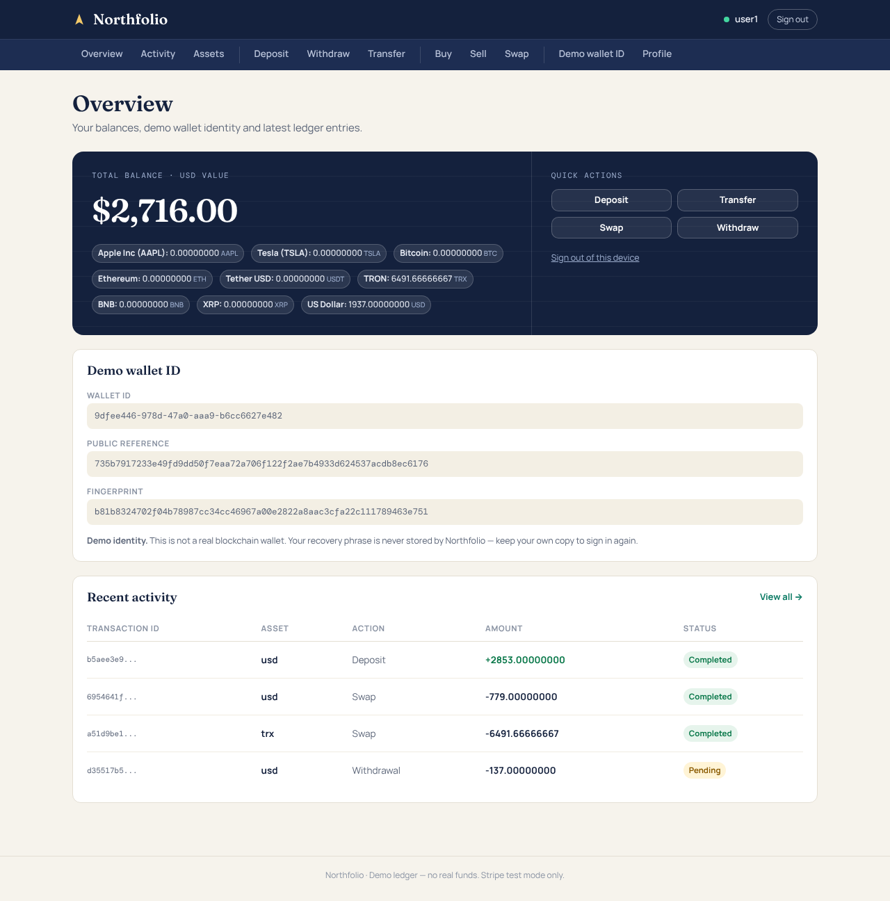
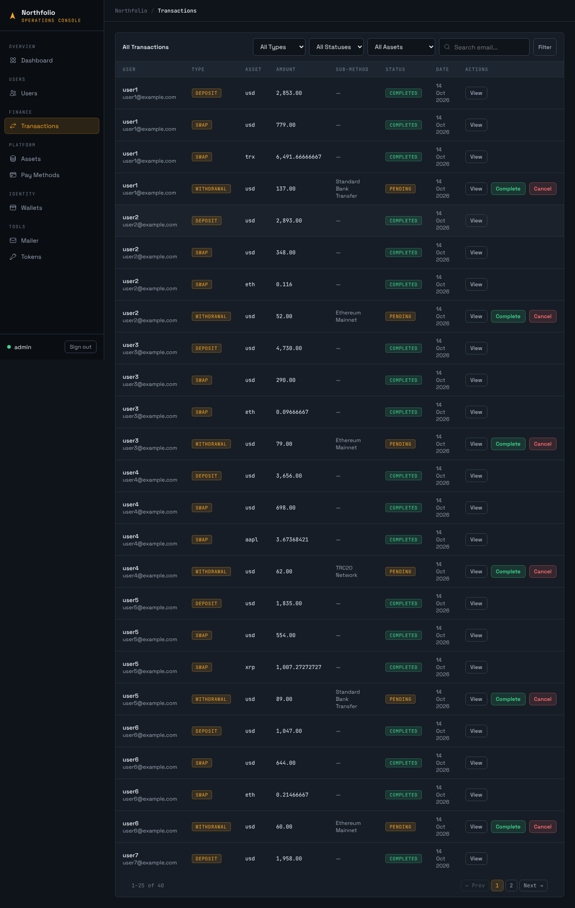

# Northfolio — Ledger-Based Wallet & Exchange Demo (Laravel 12)

> **Demo project.** Northfolio is a portfolio piece. It uses Stripe **test mode** only, trades are internal ledger entries, and the "wallet" is a demo identity — **no real money or crypto ever moves.**

A Laravel 12 backend plus Blade admin panel that models a multi-asset wallet platform: deposits, withdrawals, wallet-to-wallet transfers, swaps, buys and sells, with a single-entry transaction ledger (one row per leg; balances derived from it), audit logging and live asset pricing.





## What it demonstrates

| Area | Where to look |
|---|---|
| **Ledger design** — balances are derived from transaction rows, never stored | `app/Services/LedgerService.php` |
| **Payment integration without an SDK** — Stripe PaymentIntents + HMAC-verified, idempotent webhook | `StripePaymentService`, `StripeWebhookController` |
| **Atomic multi-leg operations** — swaps/buys/transfers as legs sharing one id; one lifecycle service owns every status change | `FundsService`, `TransactionLifecycleService` |
| **Passwordless demo identity** — genuine BIP-39 phrase (checksum-validated) → fingerprint + public ID; only derived values stored; *not* a blockchain wallet | `Bip39`, `WalletService`, `Wallet` |
| **Exact money math** — BCMath strings, `decimal(24,8)`, per-asset input precision | `Money`, `LedgerService` |
| **Live pricing with fallbacks** — CoinGecko, AlphaVantage, Finnhub | `AssetPriceService` |
| **Audit trail** — append-only-by-convention `audit_logs` for every money-affecting action (no update path in the app; not DB-enforced) | `AuditLog`, `AuditService` |
| **API + admin panel** — Sanctum REST API (`/api/v1`) and Blade admin | `routes/api.php`, `routes/web.php` |
| **Tests** — 117 tests (BIP-39 vectors, money precision, lifecycle, webhook, OTP, authorization) | `tests/` |

## Money flow (the important design choice)

```
User ──POST /deposits──▶ pending Deposit + Stripe PaymentIntent (client_secret)
                                   │ user pays with Stripe test card in Stripe.js
Stripe ──signed webhook──▶ POST /api/v1/webhooks/stripe
                                   │ signature + amount/currency/status checks, replay window 5 min, idempotent
                                   ▼
                         Deposit → Completed → USD balance credited
User ──POST /buys──▶ USD debit + asset credit + charge leg (one swap_id), completed atomically (internal ledger trade)
```

* Deposits are completed **only** by the verified webhook — not by the client, not by an admin (the admin "Complete" action is blocked for deposits).
* A buy always debits USD for the asset it credits; there is no way to credit an asset for free.
* See [docs/engineering-decisions.md](docs/engineering-decisions.md) for the full list of integrity decisions.

## Quick start

```bash
composer install           # requires PHP 8.2+ with ext-bcmath
cp .env.example .env && php artisan key:generate
touch database/database.sqlite
php artisan migrate --seed          # demo users, assets, ~30 ledger-consistent transactions
php artisan serve
```

* Admin panel: <http://localhost:8000/admin/login> — `admin@example.com` / `password`
* Demo users: `user1@example.com` … `user10@example.com` / `password`
* API base: `http://localhost:8000/api/v1` — import `postman/Northfolio-API-v1.postman_collection.json`

### Stripe test mode (optional, for deposits)

1. Create a free Stripe account and copy the **test** keys into `.env` (`STRIPE_SECRET_KEY`, `STRIPE_PUBLISHABLE_KEY`).
2. Forward webhooks: `stripe listen --forward-to localhost:8000/api/v1/webhooks/stripe` and copy the printed `whsec_…` into `STRIPE_WEBHOOK_SECRET`.
3. Pay with test card `4242 4242 4242 4242`.

Without Stripe keys everything else (buys, swaps, transfers, admin) still works; deposit creation returns a 502 "payment provider error".

### Asset prices

`php artisan` is not required: use the admin **Assets → Sync Prices** button, or hit `GET /admin/assets/sync-prices/run?key=$PRICE_SYNC_SECRET` from a cron. Seeded demo prices let Buy work offline. API keys (`COINGECKO_API_KEY`, `ALPHAVANTAGE_API_KEY`, `FINNHUB_API_KEY`) are optional.

## Interface

Three deliberately different layouts, all plain hand-written CSS (no jQuery/Bootstrap, no build step):

| Surface | Structure | Stylesheet |
|---|---|---|
| Customer portal | Two-row masthead (identity + grouped tab strip), single centred column, ledger-paper palette | `public/css/portal.css`, `layouts/user.blade.php` |
| Admin console | Fixed dark rail, slim command bar, dense monospace tables | `public/css/console.css`, `layouts/admin.blade.php`, `layouts/auth.blade.php` |
| Guest / wallet setup | Split screen: ink pitch panel + form | `public/css/entry.css`, `layouts/setup.blade.php` |

The customer pages still hydrate from the REST API with the Sanctum token in `localStorage`; the redesign changed markup and styling only.

## Tests

```bash
php artisan test      # 117 tests, in-memory SQLite (needs ext-bcmath)
```

## Documentation

* [Architecture](docs/architecture.md) · [Data model](docs/database.md) · [API](docs/api.md)
* [Engineering decisions](docs/engineering-decisions.md) · [Case study](docs/case-study.md) · [Portfolio blurb](docs/portfolio.md)
* [Security notes](docs/security.md) · [Transaction lifecycle](docs/transaction-lifecycle.md)
* [Wallet-first auth design](docs/API_WALLET_FIRST.md)

## Honest scope notes

* Withdrawals and sells are recorded and reviewed by an admin as a **simulated payout**; no real payout rail is integrated.
* Stock-like assets (AAPL, TSLA) are price-tracked units in the transaction ledger, not securities.
* The ledger is a single-entry transaction log, not double-entry bookkeeping: there are no paired debit/credit accounts or a trial balance. Multi-leg operations are linked by `swap_id`/`transfer_id`, and the platform fee is a separate leg.
* The wallet identity is a BIP-39 phrase used only as a login secret; there are no keys, addresses or on-chain activity. Do not reuse a real wallet's phrase.
* Concurrency locks are verified by simulation on SQLite only; MySQL/Postgres behaviour and the decimal migration were not run here.
* No KYC, no on-chain integration, no regulatory features — this is an engineering demo, not production-ready and not a compliant financial product.

## Stack

PHP 8.2+ (bcmath) · Laravel 12 · Sanctum · Blade · SQLite/MySQL · Stripe (test mode) · PHPUnit
